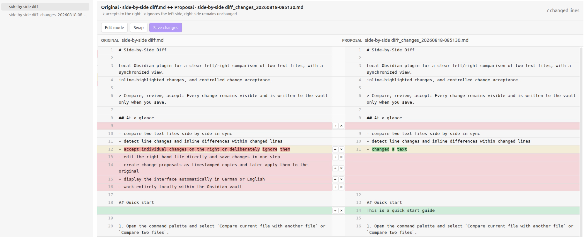
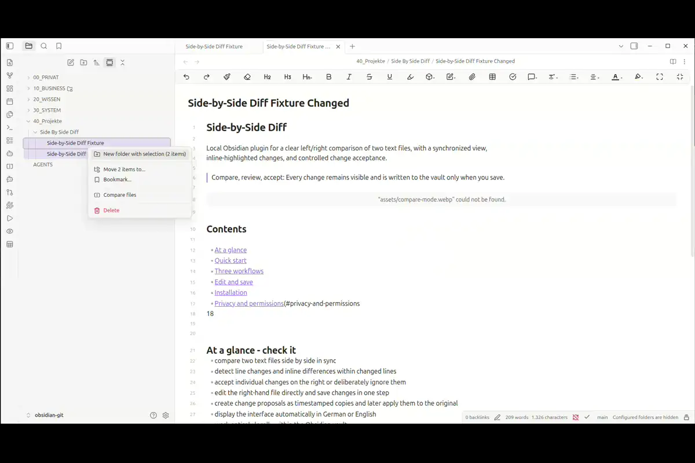
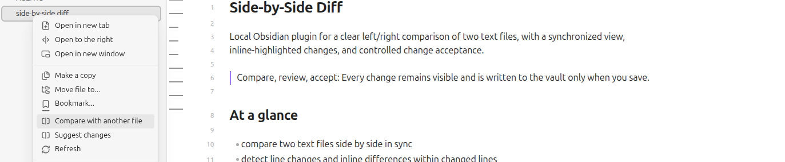

# Side-by-Side Diff

[](https://github.com/nblum/obsidian-side-by-side-diff/actions/workflows/ci.yml)
[](https://github.com/nblum/obsidian-side-by-side-diff/releases/latest)
[](LICENSE)
[](https://github.com/nblum/obsidian-side-by-side-diff)

A Markdown diff viewer for Obsidian: compare two notes or text files side by side, see exactly what changed,
and choose which changes to keep. Use it to review a revised draft, compare versions of a note, or merge selected edits into an original.

- **See the differences:** synchronized panes, a line-by-line diff, and inline highlighting within changed lines.
- **Choose what to keep:** accept or ignore individual changes or whole blocks.
- **Edit and save deliberately:** edit the right-hand file directly; changes are written only when you save.
- **Review a separate draft:** create a proposal copy and later merge selected changes back into the original.
- **Compare external Markdown:** drop a `.md` file from your computer without importing it into your vault.

Works locally, without an account or network requests. Requires **Obsidian 1.6.6 or later on desktop**.



## Get started

1. [Add to Obsidian](obsidian://show-plugin?id=side-by-side-diff), or search for `Side-by-Side Diff`
   under **Settings → Community plugins → Browse**. Install and enable the plugin.
2. Select two text files in Obsidian's file explorer, right-click, and choose `Compare files`.
3. Review the highlighted differences. Use `→` to stage a change from the **left file into the right file**,
   or `×` to ignore it and keep the right-hand content for that change.
4. Click `Save changes` or press `Ctrl/Cmd+S` to write your staged changes.

Use `Swap` before reviewing if you want to reverse the direction. Accepting a change does not save it immediately.



## In this guide

- [Other ways to open a comparison](#other-ways-to-open-a-comparison)
- [Compare, suggest, and accept changes](#compare-suggest-and-accept-changes)
- [Edit and save](#edit-and-save)
- [Compare external Markdown](#compare-external-markdown)
- [Keyboard shortcuts](#keyboard-shortcuts)
- [Settings and language](#settings-and-language)
- [Open a comparison with a link](#open-a-comparison-with-a-link)
- [Manual installation](#manual-installation)
- [Privacy and permissions](#privacy-and-permissions)
- [Feedback and support](#feedback-and-support)
- [Documentation and development](#documentation-and-development)

## Other ways to open a comparison

With a note open, choose `Compare with another file` from its document menu, then select the other file.
You can also use the comparison icon in the left ribbon or the command palette commands
`Compare current file with another file` and `Compare two files`.
The right-file selector lists your five most recently selected right-hand files first.



For a walkthrough, open **Settings → Side-by-Side Diff → Introduction** or run `Show introduction` from the
command palette. The introduction also opens once after an update if you have not seen it yet.

## Compare, suggest, and accept changes

### Compare

The left and right files are displayed in sync. Line changes and differences within a line are highlighted. Use
`Swap` to switch the files and their direction. If changes are pending, the plugin asks whether to save or discard
them first.

Contiguous changed lines, as well as changes separated only by blank lines, are grouped into one block; a block with more than three changed lines
gets `Accept all` / `Ignore all` controls to resolve it in one step. `Undo` (button or `Ctrl/Cmd+Z`) reverts the last
accept or ignore action, single row or whole block, until it is saved.

### Suggest changes

`Suggest changes` creates a copy next to the active document with a suffix and timestamp, for example
`Document_changes_20260817-143000.md`. If a matching copy already exists, the latest one is opened. The original
appears on the left and the editable proposal copy on the right.

### Accept changes

`Accept changes` appears in the document menu only when a matching change copy exists. The view is reversed so that
the copy appears on the left and the original on the right. Use `→` to selectively apply reviewed proposals to the
original. After all proposals are accepted and saved, the plugin asks whether the suffix copy should be moved to the
trash; canceling keeps the copy available.

## Edit and save

In normal diff mode, use `Edit mode` to make the right-hand side editable. The left-hand file remains read-only. If
comparison changes are pending, the plugin asks whether to save or discard them before entering edit mode. Multi-line
selection, deletion, Backspace, and `Enter` for new lines are supported.

Changes are never written automatically while typing or clicking a diff action. The file is updated only after using
`Save changes` or `Ctrl/Cmd + S`. Before saving, the plugin checks for external file changes and cancels instead of
overwriting newer content. Closing a view with unsaved changes opens a confirmation dialog.

## Compare external Markdown

Open a comparison with a vault note, then drag one `.md` file from your computer into the comparison view.
The dropped file opens on the **right**, replacing the previous right-hand file; the left-hand note stays in place.
You can also drop a vault file onto the **Drop files** card below **Select right file** to select it on the right.

Review and accept changes as usual, or use `Edit mode` to edit the external file directly.
**Saving writes to the external file on your computer**, without importing it into the vault.
Existing line endings are preserved. If the file has changed or been deleted, saving is canceled so you can
review its current contents. If it changes before you accept a suggestion, the comparison refreshes for another review.

Drop the file again after reopening the view; external file contents and paths are not stored between sessions.
If writable browser file handles are unavailable, you can compare a read-only snapshot but cannot edit or save it.
External saving depends on the Obsidian installer’s browser runtime; updating only Obsidian’s app version may not
update that runtime. Reinstalling with a recent installer can enable support.
Matching vault paths and external browser handles are rejected as the same file. Aliases through symlinks or
hard links may not be recognized, especially when one pane is a vault file; avoid comparing these aliases.
External files are never offered for trash actions.

## Keyboard shortcuts

The following shortcuts are available while a comparison view has focus:


| Shortcut | Action |
| --- | --- |
| `Alt+ArrowDown` | Go to the next change |
| `Alt+ArrowUp` | Go to the previous change |
| `Alt+ArrowRight` | Accept the highlighted change |
| `Alt+ArrowLeft` | Ignore the highlighted change |
| `Ctrl/Cmd+Z` | Undo the most recent accept or ignore action, until saving |
| `Ctrl/Cmd+S` | Save staged changes |

## Settings and language

- **Markdown sections:** enable **Align Markdown by headings** to keep matching sections aligned when reviewing
  two `.md` files. This is off by default.
- **Review navigation:** after accepting or ignoring a change, the view moves to the next open change automatically.
  You can disable this in settings.
- **Interface language:** choose a language under **Settings → Side-by-Side Diff → Language**.
  Supported languages are English, German, French, Italian, Spanish, Brazilian Portuguese, European Portuguese,
  Dutch, and Simplified Chinese. `Automatic` follows your Obsidian language, with English as the fallback.
  Traditional Chinese currently falls back to English.

## Open a comparison with a link

Create a link to open two existing vault files directly in the comparison view. Use paths relative to your vault
in `left` and `right`, replacing spaces with `%20`. For other reserved characters, use percent-encoding as well.
Add `vault` to open the link only in a vault with that exact name:

```text
obsidian://side-by-side-diff?left=Drafts/Plan%20A.md&right=Archive/Plan%20B.md&vault=Research
```

The handler reports missing or invalid paths, files outside the current vault, non-text files, identical files, and
links naming a different vault.

## Manual installation

Download the plugin files from the [latest release](https://github.com/nblum/obsidian-side-by-side-diff/releases/latest)
and place them in `.obsidian/plugins/side-by-side-diff/` in your vault. The folder must contain
`main.js`, `manifest.json`, `styles.css`, and the `locales/` directory.
Then open **Settings → Community plugins** and enable `Side-by-Side Diff`.

## Privacy and permissions

Side-by-Side Diff runs locally in Obsidian.

- It makes no network requests and uses no telemetry, analytics, ads, or external services.
- It does not require an account or payment.
- It enumerates vault file metadata (paths and names) to populate the file selectors and context actions.
- It reads and writes file contents only after an explicit user action, plus its own plugin settings.
- It accesses external Markdown files only after you explicitly drop them into the comparison view. External
  paths and browser file handles stay in memory. It writes those files only through an explicit save action, using
  access scoped to the dropped file. External reads and saves use browser file handles rather than Node’s `fs`
  module. Vault file contents continue to use Obsidian’s Vault API.

## Feedback and support

- [Report a bug or request a feature](https://github.com/nblum/obsidian-side-by-side-diff/issues/new)
- [View the latest release](https://github.com/nblum/obsidian-side-by-side-diff/releases/latest)
- [Read the changelog](CHANGELOG.md)
- [Visit the developer website](https://blum-nico.de)

If Side-by-Side Diff is useful to you, a [GitHub star](https://github.com/nblum/obsidian-side-by-side-diff) is much
appreciated.

## Documentation and development

- [Full feature reference](FEATURES.md) – supported behavior and detailed requirements
- [Contributing](CONTRIBUTING.md) – development setup, build commands, tests, and validation
- [Changelog](CHANGELOG.md) – changes by release
- [Review status concept](docs/concepts/review-statusanzeige.md) – proposed improvements to review states

The plugin source is TypeScript. Build and test instructions, project structure, and contribution guidance live in
[CONTRIBUTING.md](CONTRIBUTING.md).
