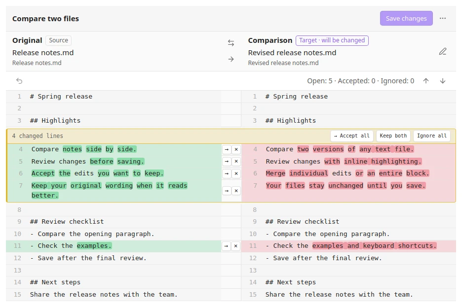
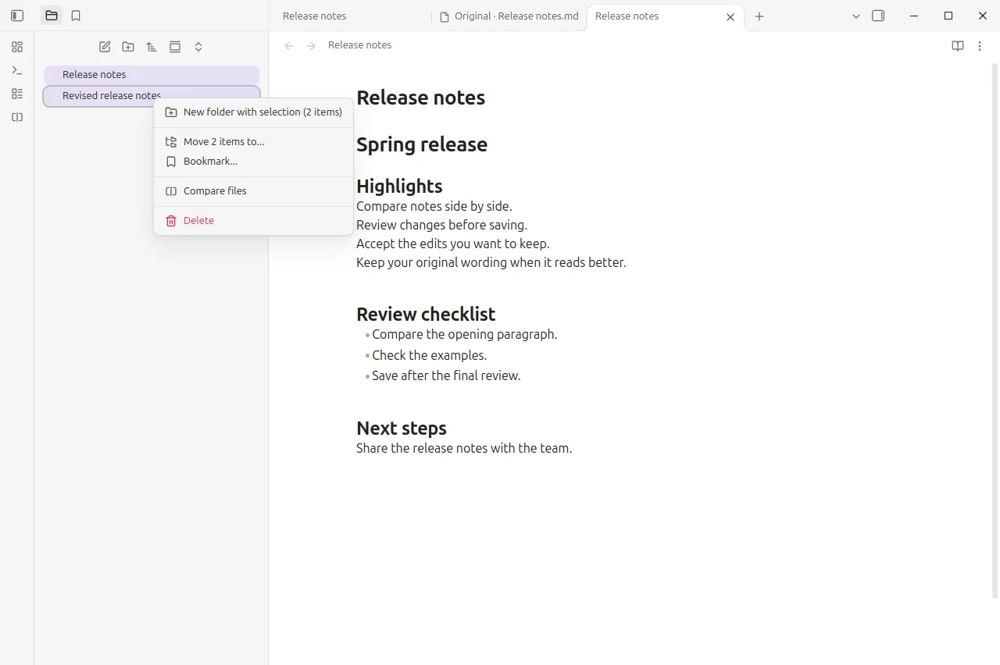
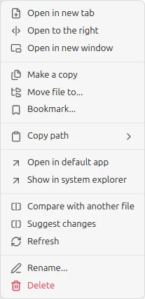
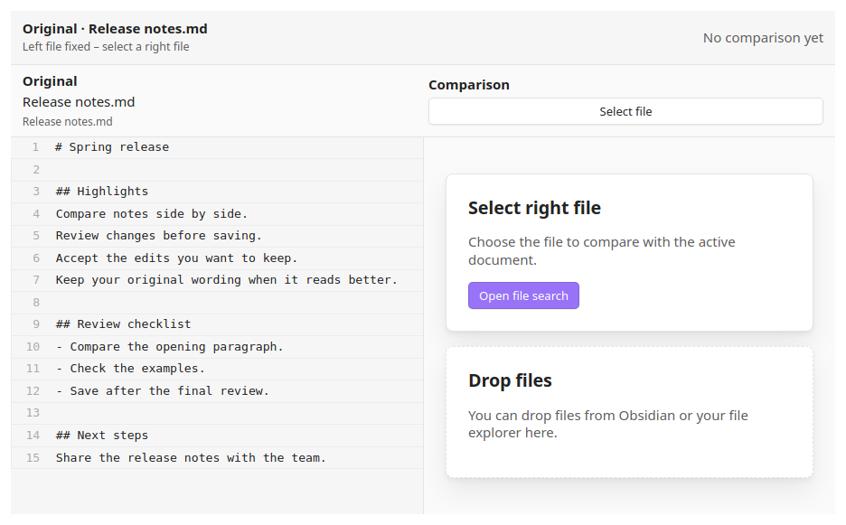
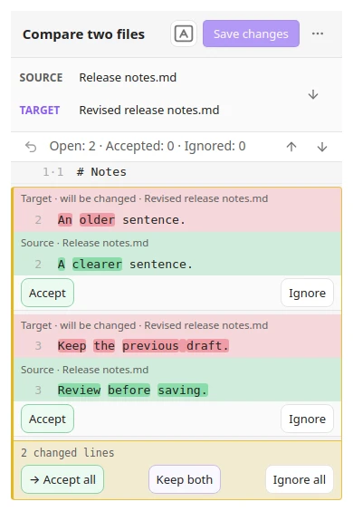
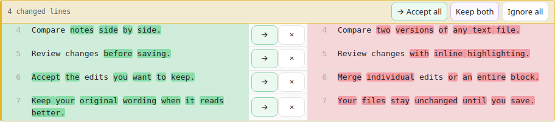
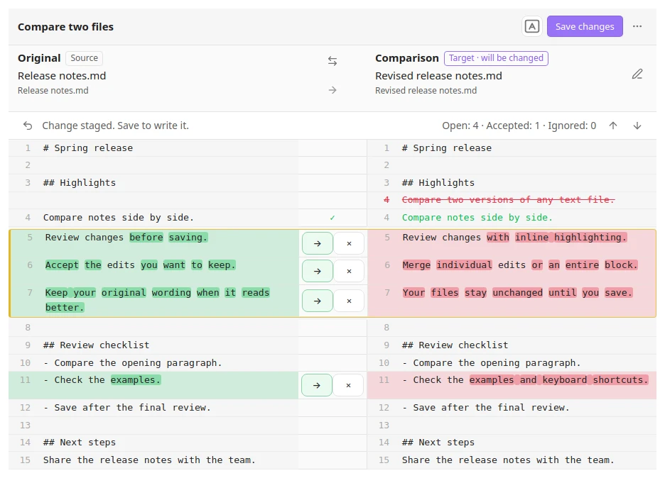
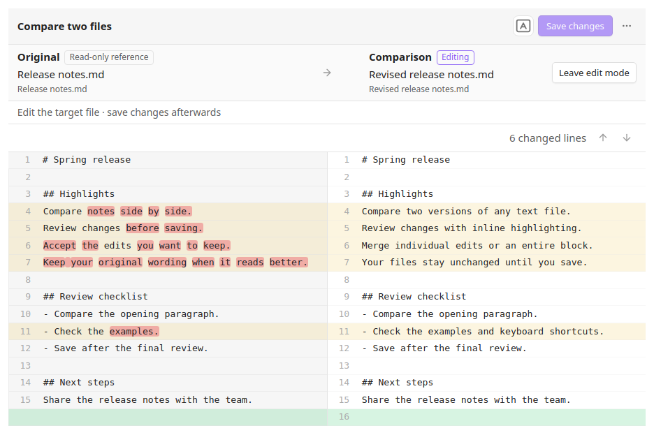
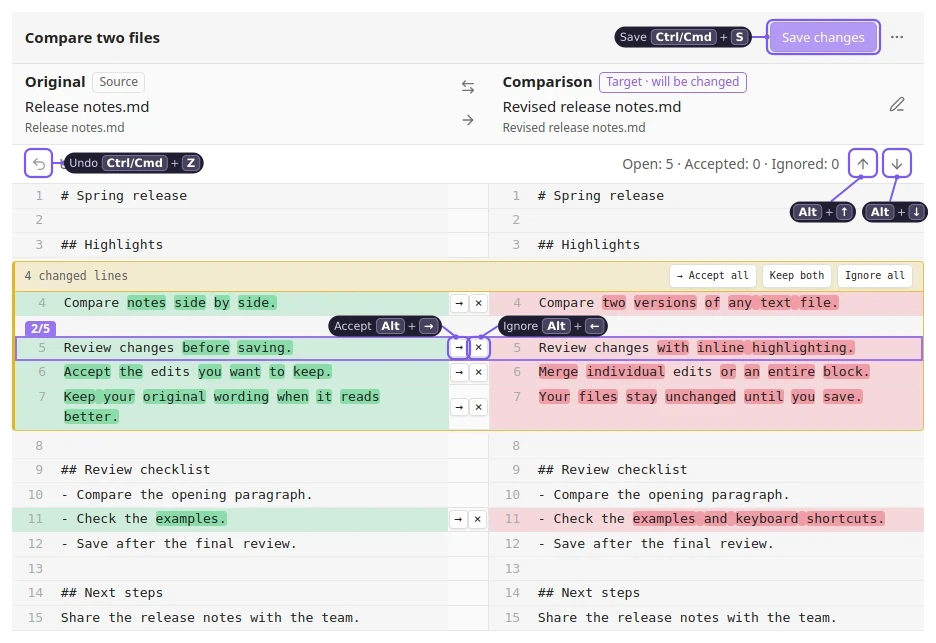

# Side-by-Side Diff

[](https://github.com/nblum/obsidian-side-by-side-diff/actions/workflows/ci.yml)
[](https://github.com/nblum/obsidian-side-by-side-diff/releases/latest)
[](LICENSE)
[](https://github.com/nblum/obsidian-side-by-side-diff)
[](https://ko-fi.com/blumnico)

A Markdown diff viewer for Obsidian: compare two notes or text files side by side or in one column, see what changed,
and choose which changes to keep. Use it to review a revised draft, compare versions of a note, or merge selected edits into an original.

- **See the differences:** synchronized panes, a line-by-line diff, and inline highlighting within changed lines.
- **Choose a layout:** compare side by side or stack variants in one column; Automatic follows the view width.
- **Choose what to keep:** accept or ignore individual changes or whole blocks.
- **Edit and save deliberately:** edit the target file directly; changes are written only when you save.
- **Review a separate draft:** create a proposal copy and later merge selected changes back into the original.
- **Compare external Markdown:** drop a `.md` file from your computer without importing it into your vault.

Works locally, without an account or network requests. Requires **Obsidian 1.6.6 or later on desktop**.



## Get started

1. [Add to Obsidian](obsidian://show-plugin?id=side-by-side-diff), or search for `Side-by-Side Diff`
   under **Settings → Community plugins → Browse**. Install and enable the plugin.
2. Select two text files in Obsidian's file explorer, right-click, and choose `Compare files`.
3. Review the highlighted differences. The arrow stages a change from **Source** into **Target** (left to right
   by default). Use `×` to ignore it; both files and their displayed text remain unchanged while the highlight clears.
4. Click `Save changes` or press `Ctrl/Cmd+S` to write your staged changes.

Use the arrow icon between the file headers to reverse the apply direction without moving the files.
Accepting a change does not save it immediately.
Until saved, accepted target text is green and removed target lines remain visible in red with strikethrough.
These text marks differ from the background highlights for open differences and disappear after saving or undoing.
Accepting changes and undoing show feedback beside the review controls. Save confirmations and errors use
Obsidian notifications.



## In this guide

- [Other ways to open a comparison](#other-ways-to-open-a-comparison)
- [Illustrated walkthrough](docs/visual-guide.md)
- [Comparison layouts](#comparison-layouts)
- [Compare, suggest, and accept changes](#compare-suggest-and-accept-changes)
- [Edit and save](#edit-and-save)
- [Compare external Markdown](#compare-external-markdown)
- [Keyboard shortcuts](#keyboard-shortcuts)
- [Settings and language](#settings-and-language)
- [Open a comparison with a link](#open-a-comparison-with-a-link)
- [Manual installation](#manual-installation)
- [Privacy and permissions](#privacy-and-permissions)
- [Feedback and support](#feedback-and-support)
- [Documentation and development](#documentation-and-development)

## Other ways to open a comparison

With a note open, choose `Compare with another file` from its document menu, then select the other file.
For two files already open in tabs, keep the original active, right-click the other tab, and choose
`Compare with active file`. The active file opens on the left and the clicked file on the right, without a picker.
The same action is available when right-clicking another text file in the file explorer while a text file is active.
You can also use the comparison icon in the left ribbon or the command palette commands
`Compare current file with another file` and `Compare two files`.
The right-file selector lists your five most recently selected right-hand files first.



After choosing the original, its text stays visible on the left. Use **Open file search** to choose the comparison
on the right, or use the **Drop files** card.



For a walkthrough, open **Settings → Side-by-Side Diff → Introduction** or run `Show introduction` from the
command palette. The introduction also opens once after an update if you have not seen it yet.

In an open comparison, choose **Help** from the `…` file-actions menu to read this guide in a dialog.
The guide and its screenshots are bundled with the plugin and work offline; links to other project documents open on GitHub.

## Comparison layouts

Use the icon button beside Save to cycle **Automatic → Side by side → Single column → Automatic**. Its icon
shows an A, two columns, or two stacked rows; the tooltip names the current and next choice. Automatic uses one column
when the comparison is narrower than 720 pixels, including a narrow desktop split. Configure the default for new
comparisons in settings; each open comparison remembers its selected preference.

Single column shows equal text once, with both files' line numbers. Changed rows show the target version first,
then the incoming source version, with file labels and compact Accept / Ignore buttons aligned left and right.
The buttons sit directly beneath their change, with a small gap separating them from the next change.
Blocks with at least two open changed rows offer Accept all / Ignore all below their content, plus Keep both
when both versions contain text. Block actions, Keep both, review progress, navigation, and Undo work in either layout. Switching layouts preserves staged changes and
never saves them.

In single-column comparisons, copying includes both selected variants in reading order and shared text once.
Line numbers, labels, controls, alignment gaps and staged deletion previews are excluded.
Narrow views show compact Source/Target file rows and one direction button. Swap and the edit entry are hidden;
folders appear only for matching filenames. An editor opened in a wider view remains available after resizing.
The edit entry is also hidden in wide single-column comparisons. Button heights stay the same when switching
layouts; larger touch targets depend on the mobile device, not the chosen layout.
The square layout button matches Save's height and scales its icon to fill the available space.
In single-column edit mode, the target uses the full width and the source is a collapsible reference above it.
Changing layout or resizing keeps the live editor and its undo history.



## Compare, suggest, and accept changes

### Compare

In the side-by-side layout, the left and right files are displayed in sync. The file headers identify the
**Original** and **Comparison**,
their paths, and the current **Source** and **Target**. `Undo` and change navigation sit directly above the content.
The arrow icon between the headers reverses the apply direction while preserving file positions. Green marks source
content to be added; red marks target content to be removed or replaced. The colors follow the selected direction.
The `Swap` icon sits above the direction arrow. The pencil icon beside the target file opens edit mode and moves
with the target when direction changes; saving and
the file-actions menu stay in the first toolbar row.
Save or undo pending changes before reversing; ignored decisions are reopened for the new direction.
The direction is restored with a saved vault comparison. `Swap` exchanges the files' positions; their Original and
Comparison labels follow the files. If changes are pending, it asks whether to save or discard them first.
See the [right-to-left example](docs/visual-guide.md#reverse-the-apply-direction) for the resulting file roles and colors.

In side-by-side mode, select text in either file and press `Ctrl/Cmd+C` to copy it. Selection stays in the starting
pane and copies only that file's text, excluding line numbers, review controls, and visual alignment gaps. Single-column
copying includes both selected variants in reading order, with shared text once.

Contiguous changed lines, as well as changes separated only by blank lines, are grouped into one block; side-by-side blocks with more than three open changed lines
get `Accept all` / `Ignore all` above the block. Single-column blocks show these actions below the content from
two open changed lines onward. They resolve the block in one step. `Undo` (button or `Ctrl/Cmd+Z`) reverts the last
accept or ignore action, single row or whole block, until it is saved.



When both versions contain text, the block actions also offer **Keep both**. It retains the existing target text,
adds a blank line, then appends the source version in the selected merge direction. Previously accepted or ignored
rows and unchanged separator lines split the action into independent open fragments and remain untouched.
The result stays staged, and one Undo reverses the entire block action. Added-only or removed-only blocks retain
their usual accept/ignore controls.

Accepted changes stay staged until you save. In this example, the target shows its previous line in red with
strikethrough and the incoming text in green. The feedback beside `Undo` confirms that the change is staged.



The summary beside the previous/next arrows above the split counts **Open**, **Accepted**, and **Ignored** changed
lines. Open changes keep their accept/ignore buttons; check and minus markers identify accepted and ignored changes. Navigation visits open changes only.
Undo restores the previous decision. The highlighted change frame has a badge such as **5/12** on its top border,
showing its position among the currently open changes.
Accepted means staged: save explicitly to write it. After saving, accepted counts reset while ignored differences
stay ignored. Finishing a review can therefore leave the files different.

Ignoring preserves both versions; see the [ignored-change example](docs/visual-guide.md#ignore-a-change).

### Suggest changes

`Suggest changes` creates a copy next to the active document with a suffix and timestamp, for example
`Document_changes_20260817-143000.md`. If a matching copy already exists, the latest one is opened. The original
appears on the left and the editable proposal copy on the right.

### Accept changes

`Accept changes` appears in the document menu only when a matching change copy exists. The view is reversed so that
the copy appears on the left and the original on the right. Use `→` to selectively apply reviewed proposals to the
original. After all proposals are accepted and saved, the plugin asks whether the suffix copy should be moved to the
trash; canceling keeps the copy available.

## Edit and save

In a wide side-by-side comparison, use the target's pencil icon to enter `Edit mode`. Single-column and narrow
comparisons hide this entry; an already open editor remains usable after changing layout or width. Only the target can be edited: right for
left-to-right merging, left for right-to-left merging. The source stays read-only. If
comparison changes are pending, the plugin asks whether to save or discard them before entering edit mode. Multi-line
selection, deletion, Backspace, and `Enter` for new lines are supported.

Changes are never written automatically while typing or clicking a diff action. The file is updated only after using
`Save changes` or `Ctrl/Cmd + S`. Before saving, the plugin checks for external file changes and cancels instead of
overwriting newer content. Use **Leave edit mode** to return to comparison. Unsaved edits offer **Save**,
**Discard changes**, or **Cancel**; Escape also keeps editing. A failed save preserves the editor and its text.
Closing a view with unsaved changes opens a confirmation dialog.
The [save-or-discard example](docs/visual-guide.md#handle-unsaved-changes) shows the same protection before swapping files.



## Compare external Markdown

Open a comparison with a vault note, then drag one `.md` file from your computer into the comparison view.
The dropped file opens on the **right**, replacing the previous right-hand file; the left-hand note stays in place.
You can also drop a vault file onto the **Drop files** card below **Select right file** to select it on the right.

Review and accept changes as usual. When the external file is the target, its pencil icon opens direct editing.
**Saving writes to the selected target**: an external target is saved on your computer without importing it into
the vault; reversing the direction makes the vault file the editable target.
Existing line endings are preserved. If the file has changed or been deleted, saving is canceled so you can
review its current contents. If it changes before you accept a suggestion, the comparison refreshes for another review.

Drop the file again after reopening the view; external file contents and paths are not stored between sessions.
If writable browser file handles are unavailable, you can compare a read-only snapshot and reverse the apply direction
to merge it into the vault file. The snapshot itself cannot be edited or saved.
External saving depends on the Obsidian installer’s browser runtime; updating only Obsidian’s app version may not
update that runtime. Reinstalling with a recent installer can enable support.
Matching vault paths and external browser handles are rejected as the same file. Aliases through symlinks or
hard links may not be recognized, especially when one pane is a vault file; avoid comparing these aliases.
External files are never offered for trash actions.

## Keyboard shortcuts

The following shortcuts are available while a comparison view has focus:



| Shortcut | Action |
| --- | --- |
| `Alt+ArrowDown` | Go to the next change |
| `Alt+ArrowUp` | Go to the previous change |
| `Alt+ArrowRight` | Accept the highlighted change in the selected apply direction |
| `Alt+ArrowLeft` | Ignore the highlighted change |
| `Ctrl/Cmd+Z` | Undo the most recent accept or ignore action, until saving |
| `Ctrl/Cmd+S` | Save staged changes |

## Settings and language

- **Default comparison layout:** Automatic, Side by side, or Single column for new comparisons.
- **Default apply direction:** choose **Left → right** or **Right → left** for new comparisons. Open or restored
  comparisons keep their own direction. Proposal acceptance stays directed into the original file.
- **Markdown sections:** enable **Align Markdown by headings** to keep matching sections aligned when reviewing
  two `.md` files. This is off by default.
- **Review navigation:** after accepting or ignoring a change, the view moves to the next open change automatically.
  You can disable this in settings.
- **Interface language:** choose a language under **Settings → Side-by-Side Diff → Language**.
  Supported languages are English, German, French, Italian, Spanish, Brazilian Portuguese, European Portuguese,
  Dutch, and Simplified Chinese. `Automatic` follows your Obsidian language, with English as the fallback.
  Traditional Chinese currently falls back to English.

## Open a comparison with a link

Create a link to open two existing vault files directly in the comparison view. Use paths relative to your vault
in `left` and `right`, replacing spaces with `%20`. For other reserved characters, use percent-encoding as well.
Add `vault` to open the link only in a vault with that exact name:

```text
obsidian://side-by-side-diff?left=Drafts/Plan%20A.md&right=Archive/Plan%20B.md&vault=Research
```

The handler reports missing or invalid paths, files outside the current vault, non-text files, identical files, and
links naming a different vault.

## Manual installation

Download the plugin files from the [latest release](https://github.com/nblum/obsidian-side-by-side-diff/releases/latest)
and place them in `.obsidian/plugins/side-by-side-diff/` in your vault. The folder must contain
`main.js`, `manifest.json`, `styles.css`, and the `locales/` directory.
Then open **Settings → Community plugins** and enable `Side-by-Side Diff`.

## Privacy and permissions

Side-by-Side Diff runs locally in Obsidian.

- It makes no network requests and uses no telemetry, analytics, ads, or external services.
- It does not require an account or payment.
- It enumerates vault file metadata (paths and names) to populate the file selectors and context actions.
- It reads and writes file contents only after an explicit user action, plus its own plugin settings.
- It accesses external Markdown files only after you explicitly drop them into the comparison view. External
  paths and browser file handles stay in memory. It writes those files only through an explicit save action, using
  access scoped to the dropped file. External reads and saves use browser file handles rather than Node’s `fs`
  module. Vault file contents continue to use Obsidian’s Vault API.

## Feedback and support

- [Report a bug or request a feature](https://github.com/nblum/obsidian-side-by-side-diff/issues/new)
- [View the latest release](https://github.com/nblum/obsidian-side-by-side-diff/releases/latest)
- [Read the changelog](CHANGELOG.md)
- [Visit the developer website](https://blum-nico.de)
- [Buy me a coffee](https://ko-fi.com/blumnico)

If Side-by-Side Diff is useful to you, a [GitHub star](https://github.com/nblum/obsidian-side-by-side-diff) is much
appreciated.

## Documentation and development

- [Illustrated walkthrough](docs/visual-guide.md) – file selection, review states, editing, and explicit saving
- [Full feature reference](FEATURES.md) – supported behavior and detailed requirements
- [Roadmap](ROADMAP.md) – candidate and planned features, with links to detailed concepts
- [Contributing](CONTRIBUTING.md) – development setup, build commands, tests, and validation
- [Changelog](CHANGELOG.md) – changes by release
- [Review status concept](docs/concepts/review-statusanzeige.md) – review states, counts, and session lifecycle

The plugin source is TypeScript. Build and test instructions, project structure, and contribution guidance live in
[CONTRIBUTING.md](CONTRIBUTING.md).
