# Illustrated comparison walkthrough

These screenshots use two sample notes, `Release notes.md` and `Revised release notes.md`, in an isolated vault.
They show the English interface with Obsidian's default light theme. Your notes keep their literal Markdown;
review actions stage changes until you explicitly save.

## Start from the file explorer

Select two text files, right-click, and choose **Compare files**. Use `Alt`-click on Windows/Linux or `Option`-click
on macOS to select individual files, as described in [Obsidian's file explorer guide](https://obsidian.md/help/plugins/file-explorer).

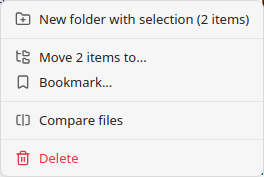

To start with one note, choose **Compare with another file** from its context menu. You can also use the ribbon
icon or the command palette. With a different text note active, **Compare with active file** opens both files directly.

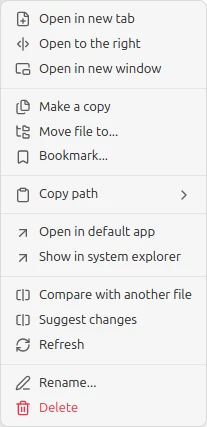

## Select the comparison file

The original remains visible on the left before you choose the comparison. **Open file search** opens the vault
file picker. The **Drop files** card accepts a vault file or an external Markdown file.

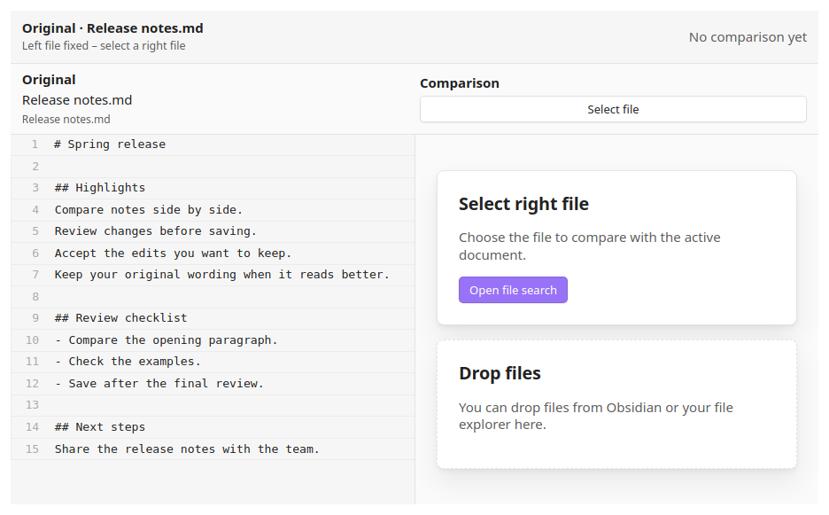

## Read the comparison

The headers identify the **Original** and **Comparison**, along with the current **Source** and **Target**.
Green source content will be inserted; red target content will be removed or replaced if you accept it. Inline
highlights identify the changed words within a line. Arrow buttons between the panes accept individual changes;
`×` ignores them. The summary beside the navigation arrows counts open, accepted, and ignored changed lines.
Open rows keep their action buttons; check and minus markers identify accepted and ignored rows. Previous/next controls navigate between
open changes.

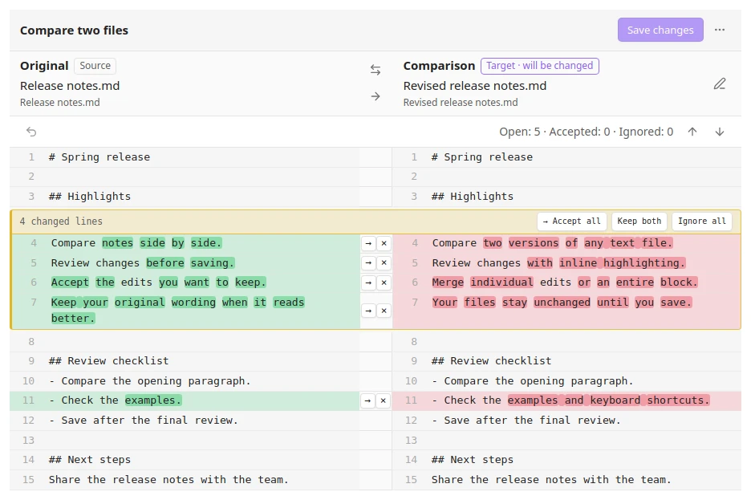

## Reverse the apply direction

The arrow between the file headers reverses the direction while keeping the files in place. In this example,
the left file becomes the target and the right file supplies incoming content. The target's pencil icon moves
with its role. Save or undo pending changes before reversing direction.

**Swap**, above the direction arrow, exchanges the file positions instead.

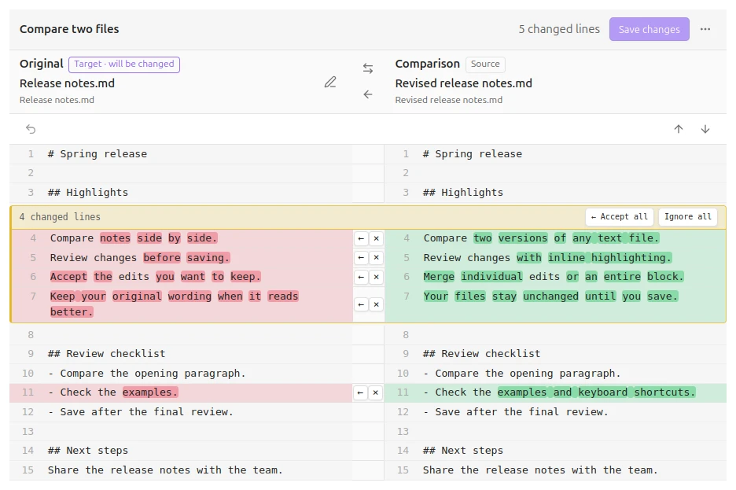

## Resolve a whole block

A block with more than three changed lines offers **Accept all** and **Ignore all**. These actions resolve the
block in one step; a single **Undo** reverses that step. Accept all skips changes you already ignored individually.

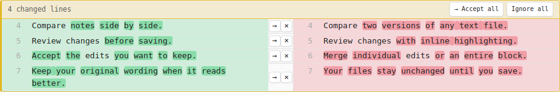

## Review staged changes before saving

Accepting a change updates the target preview. New target text is green; the previous target line remains visible
in red with strikethrough. Deleted previews are excluded from copied and saved target content. Feedback beside
the review controls confirms that the change is staged; its row gains a check marker and the Accepted count increases.
The files on disk remain unchanged.

Use **Undo** or `Ctrl/Cmd+Z` to reverse an accept or ignore action before saving.

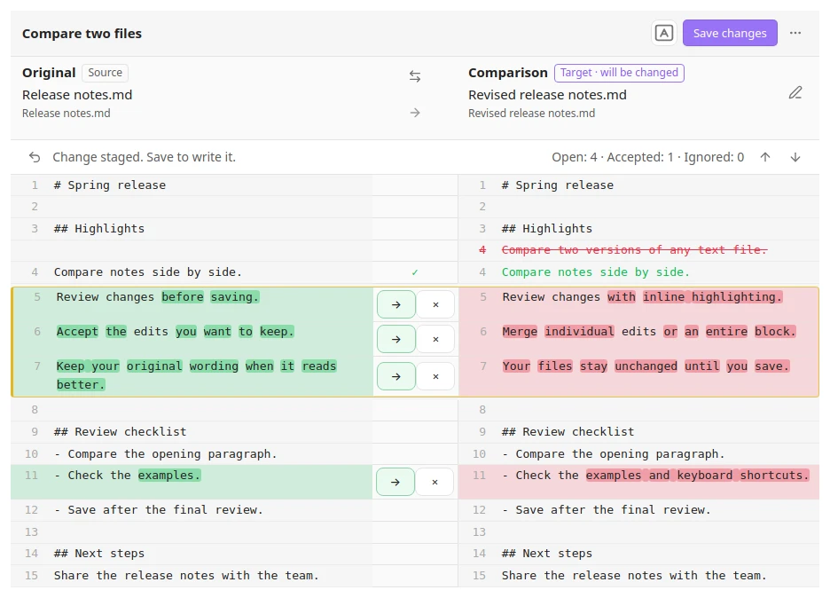

## Ignore a change

Ignoring removes the row's review highlights and actions while preserving both files' displayed text and line
numbers. A minus marker identifies the ignored row, and the summary counts the decision. Ignoring every difference
completes the review, but does not make the files identical. Undo restores the review action.

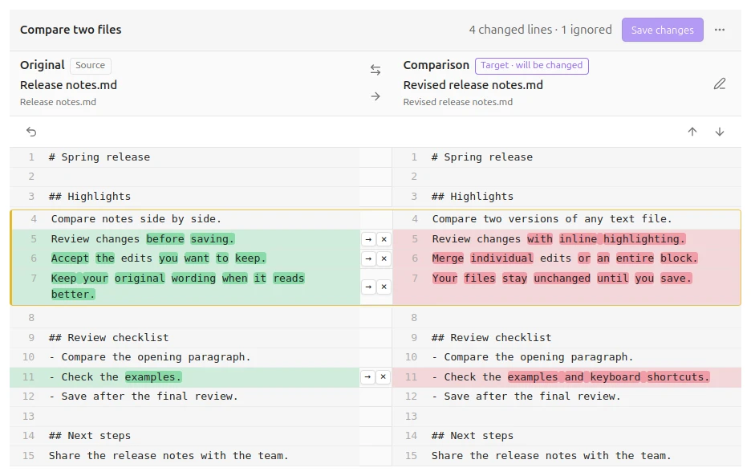

## Edit the target directly

The pencil icon opens **Edit mode** for the current target. The source remains read-only beside it. This works
on either target side, and typing remains staged until **Save changes** or `Ctrl/Cmd+S`. The comparison-mode icon
returns to reviewing differences.

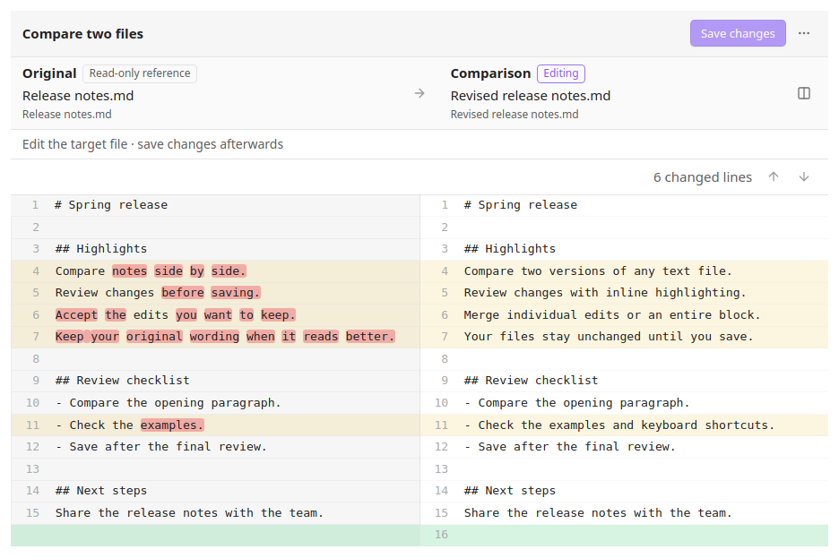

## Handle unsaved changes

Actions that would replace pending work prompt you to save or discard it. This example appears before swapping
the files. **Save** writes the staged changes before continuing; **Don't save** discards the pending changes.
Dismissing the dialog keeps the current comparison and its pending work.

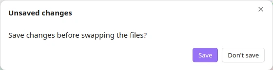

## Confirm the saved result

**Save changes** writes the staged target content after checking for external changes. If another edit changed
the file since you opened the comparison, saving is canceled and your staged changes remain available for review.

After a successful save, accepted counts reset while ignored differences remain resolved. After accepting and
saving all differences in these sample notes, both files are identical and Save is disabled.
The identical-file message offers a separate, confirmed trash action; review completion alone does not offer that
proof of equality.

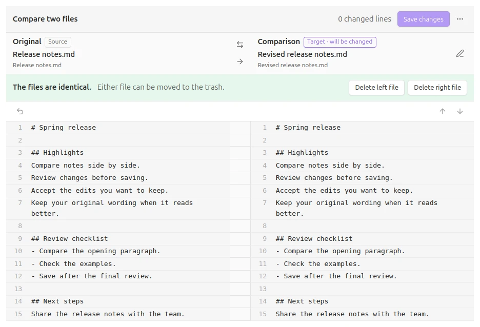

## Watch the complete workflow

The animation shows native file selection, opening the comparison, accepting changes, and explicitly saving them.

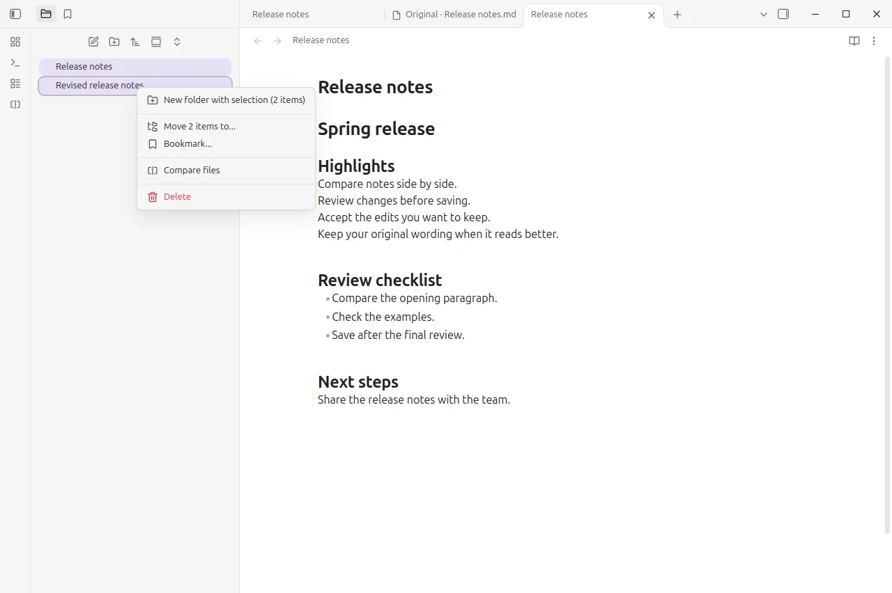

For keyboard shortcuts, external-file permissions, and other entry points, see the [README](../README.md).
To refresh these images after UI changes, use the [documentation capture workflow](../CONTRIBUTING.md#refreshing-documentation-screenshots).
